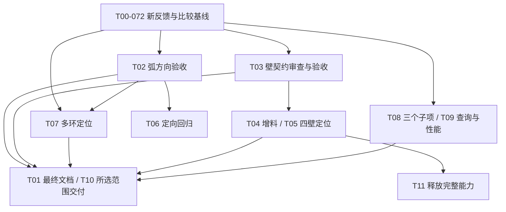

# 0.7.2 反馈开发完善 Implementation Plan（DEV-051 续版）

状态：历史规划已归档（2026-10-29）；“未指派、未实施”等描述保留原编写时点。2026-10-30 用户确认的最新逐项对账和排序见 [当前完善计划](../superpowers/plans/2026-10-30-feedback-072-to-085.md)：BUG-032 板厚同步 → T11 有效材料场景释放 → T05 四壁 → T13 bundle → T09D 性能调查。实施状态以 DEV-051 工作卡与 BACKLOG 为准，不能将已交付子项重复派发，也不能将阶段通过算作整批完成。**2026-10-30 同日该链已按离线阶段推进到第十个提交（HEAD `768c673`），全部离线交付、实机待验**，逐项状态见 [DEV-051 工作卡](../work-items/DEV-051.md#2026-10-30-离线批次十个提交与当前状态矩阵)。

> **For agentic workers:** REQUIRED SUB-SKILL: Use subagent-driven-development or executing-plans to implement this plan task-by-task. Steps use checkbox (`- [ ]`) syntax for tracking.

**Goal:** 合并四份 0.7.2 新反馈、已发布能力和 DEV-051 在做内容，先完成弧方向与钣金基础的真实验收，再处理多环切除、四壁和预览，分批交付剩余能力。

**Architecture:** 保留 MCP → Python 准入/调度 → 原生 Toolkit → Creo 的现有架构。Python 不模拟 Creo 几何；入参分析、原生实际回读与独立几何期望分别取证。继续使用 DEV-051 和 T00—T13，不新建一套重复工作 ID。

**Tech Stack:** Windows x64、Python 3.12+、Pydantic、unittest、C++17、MSVC、Creo Toolkit；本机原生验收使用 Creo 12.4.0.0 / 匹配 SDK。

**Spec:** 本文的比较矩阵、任务范围与验收标准；依据[四份 0.7.2 原件及 manifest](../validation/feedback-0.7.2-2026-10-28/manifest.json)、[逐章映射](../validation/feedback-0.7.2-2026-10-28/MAPPING.md)、[原 0.7.0 总计划](0.7.0-FEEDBACK-PLAN-2026-10-28.md)、[原派发表](0.7.0-FEEDBACK-TASKS-2026-10-28.md)、[统一台账](../BACKLOG.md)及各条工作卡。

日期：2026-10-28（Asia/Shanghai）。这是本轮新的规划与后续派发入口；与旧计划冲突时以本文为准，旧计划保留当时过程和未冲突的细节。此次完成文件读取、比较、反馈归档和计划编写；没有执行单元、构建、实机或 WorkBuddy，没有修改建模实现、版本或发布。后续实现按获指派范围推进，计划本身不代表整批已经开工。

## 一、比较对象和状态边界

| 层次 | 本轮本地核对结果 | 可得出的结论 |
| --- | --- | --- |
| 已交付基线 | `version.py=0.7.2`；本地 `main` 与 `v0.7.2^{commit}` 均为 `2b677f53422102fc14109871f1794b627274a09f` | 发布范围以 [0.7.2 说明](../RELEASE_NOTES_0.7.2.md)和[发布验收](../validation/RELEASE-0.7.2.md)为准；本次没有重新查询远端或下载附件 |
| 已提交的后续开发 | 分支 `codex/dev051-feedback070`；最终核对HEAD `f10bee750d6c9d582839306b2ffc029997bfb339`，包含T00 `2726ca5`、T02 `a3c1f4b`、T03实现`601b4bc`及验收卡补正`f10bee7` | T02/T03均已离线提交，但未发布、未原生验收，不能归入正式0.7.2 |
| 编写期间的新进展 | 首次读取时T03尚未提交；最终核对已取得[T03验收卡](DEV051-T03-ACCEPTANCE.md)：18项专项、全量dev_check success=true与构建通过，实机未执行 | 新计划按最新提交接续，不再派发“从草稿起步”；T02较早的安装沙箱失败保留为历史，不作为当前仍失败结论 |
| 新外部反馈 | 下载目录仅四份 Markdown，无 JSON、PRT、原始图片等附件 | 三份包含实机叙述，一份明确未连接 Creo；静态判断、引用发布证据、作者推测另列 |
| 运行服务 | 本次未查询 MCP 身份、未连接 Toolkit | 版本号相同不能证明服务加载了 T02/T03；实际验收须绑定部署源码指纹 |

工作区还存在运行产物和其他客户端文件，本次保留。接手时重新核对是否有后续提交，不重建、覆盖或回退他人改动。T03全量检查报告记录的是`a3c1f4b + dirty`工作树，`checked_source_sha256=cb2dc045234a2091feef88f3a1062dc7b72d5208c4bd20d6e05cb982bd7c9d98`；不能仅凭HEAD将其冒充干净树运行。T03提交后专项报告的`source_fingerprint=fc7ced085fd0ea26aad16f0e321a0475cc74aa4325748a9adce3ab54afccf127`，两种指纹算法/范围不同，不直接比较。

四份来源使用 `R72-1`—`R72-4` 编号，避免与旧 0.7.0 报告的 R1—R4 混淆。原件字节数依次为 6455、10456、8926、10715；完整 SHA256 与证据方法见 manifest。`R72-3` 为安装/静态报告，不能计为 Creo 建模验收；`R72-4` 的纯轴向 `u_axis` 明确未本轮重测，仍算历史证据。

## 二、与旧总计划、发布版和在做内容逐项比较

| 事项 / 新证据 | 正式 0.7.2 | 当前开发状态 | 新计划决定 / 既有归属 |
| --- | --- | --- | --- |
| 弧方向；R72-2 再现 142.699081698 与 1428.097245102 mm³ 两种结果 | 尚无显式 `dir`，缺省 CCW；两体积符合旧契约 | **T02 已提交离线实现**：严格 `dir=±1`、分析/创建/更新贯通、实际弧回显 | **继续 T02 验收，不重做设计**；FEAT-034，P1；保留旧请求几何，显式 CW 表达新意图 |
| 线长185、depth1/t232 得9957440；R72-1 S5 | 再次报告失败；“被覆盖”仍是现象解释 | **T03离线已提交**：单开放直线准入、厚度轴驱动面、体积检查；静态定位指向旧最大面选择 | **T03优先原生验收**；BUG-032，P1；静态定因与真实几何验证分开，未实机不能写已修复 |
| 钣金真实重叠 add 失败，同件 cut 可行；R72-1 S1 | 实测仍失败 | 没有可确认的 T04 新实现/验收 | 保持 **T04 / BUG-046，P1**；普通件add、钣金add/cut做同截面对照 |
| 1mm底板前两折边成功、第三失败、第四未执行；R72-1 S3 | 实测仍失败 | T05/T11 仍为计划 | **T05 定位、T11 新释放能力**；BUG-047/FEAT-014；不预设角部干涉是根因 |
| 新星形件同倾斜面矩形、30图元及后续5斜槽成功；R72-4 §2 | **新增外部 Creo 10 报告通过**；本机六例已有0.7.2证据 | 未实施 T06 新修复 | **T06 从P1修复转为定向回归/证据收口**；不再把新件倾斜草图整体写为当前阻断；原JSON/PRT仍未获得 |
| 同件2圆cut成功，5个四弧环失败；R72-4 §4 | 构型失败重复出现；本项目另有7轮廓成功证据 | DEV-049替代驱动已在，T07未实机 | **T07 / BUG-049，P1**；不是“上限2”，不增加虚构的 `supported=2` |
| 空件 raster=0、output_file=-4，后续同会话可成功；R72-1 N3 | **间歇失败新增线索** | BUG-088 已登记，T08A未实施 | 保留 **T08A，P2**；先采路径/实际文件系统错误，不据此认定句柄占用 |
| 有文件但条带状图像、view_matrix_matches=false；R72-2/4 | 内容/视角问题继续存在 | T08C未实施；源码原已只比较3×3 | **T08C，P2**；推翻“改为3×3即可解决”的直接处方，先核对尺度、旋转与真实图像 |
| 钣金body=2，普通件=1；R72-1 N1 | 再次观测 | T08B未实施 | **T08B / BUG-040，P2**；查真实body类型/状态/材料体归属，不硬减1 |
| 断连登记、BUG-079回填、旧报告归档；R72-3 | **已交付且获外部静态确认**；断连根因仍未定 | DEV-051入口仍写“只有T00完成” | T01只修当前口径；BUG-085继续缺证调查；不重复登记或重跑已完成种子15+2 |
| BUG-081/082“当前核对”停在0.6.0，BUG-056目标未排期；R72-3 §4 | 当前入口与历史时点易混淆 | T01未完成 | 纳入 **T01**：保留旧时间点，追加当前核对及仍开放范围 |
| “无删除、无批处理、标签未说明”；R72-4 §5/8 | 已有 `feature_state`、多操作 `execute_plan`、标签规则和独立draft | 发现路径仍需改善 | **T01 / FEAT-008**：补可运行示例和失败语义；不新增同义删除/批处理工具 |
| 1408边时单job约50–60秒；R72-4 §5 | 单次观测，尚无分阶段基准 | 无性能验收 | 新增 **T09D 调查子任务**，复用FEAT-008/033、DEV-006/007；先区分调用开销、原生求解、检查、保存重载 |
| 组件业务label / 实际回转轴；R72-2 §7 | 仍有使用与可观测性缺口 | T09A/B仅计划 | 保留T09A/B；不改物理副本名、不以请求轴冒充实际解析轴 |
| 原生沉孔/沉头孔 / 装配native_bundle | 尚未交付 | T12/T13仅计划 | 继续FEAT-035、FEAT-031；第二批独立设计和验收 |
| cursor:null、状态过滤、错误阶段标识、changelog入口 | 新报告未复测或沿用建议 | T09C等仍是候选 | 不因本轮未提而丢弃旧计划：cursor协议复核独立，状态过滤/结构化阶段/有界版本说明入口分别评估 |
| S2折边方向、S6固定面、P3 plane offset、P5旋转反手等 | R72-1明确本轮未复测 | 原条目继续开放 | 保留BUG-047/060/061/045及FEAT-001/BUG-011各自边界，不能写成0.7.2本轮全部失败 |

### 本轮必须澄清的判断

1. **T02/T03已离线提交，均未发布或原生验收。** 四份报告对正式0.7.2的失败不等于对当前开发改动的反证；开发提交存在也不等于这些外部问题已修复。
2. **闭合数量不证明整体几何合法。** “5闭环/0开放端”不能排除相切、自交、重复、嵌套方向、引用或特征适用性，更不能推出“两环上限”或 section 传参根因。
3. **预览归因需要重做。** `native/preview.h::preview_rotation_matches` 已是 `row<3,column<3`；R72-2所说比较了第4列与它自己引用的代码矛盾。尺度影响和容差是否合适仍要实际矩阵证明，不能只放宽阈值。
4. **新件通过不证明历史污染机制从未存在。** R72-4已提供有价值的外部成功结果，但“从根上修掉污染”仍超出证据；当前无需围绕该假设再加P1修复。
5. **报告包含笔误和静态采信。** R72-3把BUG-087写成“不平行则跳过”，实际是跳过平行候选；该报告未连接Creo，其6/6是引用发布证据。报告原件保持原文，解释写在映射中。
6. **前项 rolled_back 不能续用。** 失败计划里“前两折边执行成功”与“已保留前两折边”是不同事实；必须依据最终revision和保存基线重建前置特征。

## 三、范围选择、分批和版本

可选三条路线：A为一个大版本捆绑全部问题，反馈闭环完整但容易被缺附件和新能力拖延；B为只发弧方向，交付最快但钣金关键链路继续悬空；**推荐C：按可验收子批滚动交付**，先收口在做的T02/T03并开展T07/T04定位，任何未通过的范围留在台账，不借“整批完成”关闭。

| 子批 | 内容与退出条件 | 版本处理 |
| --- | --- | --- |
| A 在做内容收口 | T00-072归档/比较已完成；T01当前说明；T02真实创建/编辑/回显闭环；T03审核后取得壁参数/下游实机结果 | 含显式弧方向时为下一未占用 **MINOR，当前候选0.8.0**。T03若未通过可单列继续，不能随包声称修复；集成源码须取得适用全量检查通过 |
| B 现有建模阻塞 | T07多环与T04增料为重点，T05给四壁确定结论；T08A/B/C分别验收；T06只做涉及草图变更的定向回归 | 仅兼容修复按下一未占用PATCH；新增relief/查询能力按MINOR，按最终范围判定 |
| C 能力扩展 | T11四壁释放、T12原生孔、T13装配打包；T09A/B/D按收益独立选择 | 各自可交付，不要求三项同时完成；新能力使用下一未占用MINOR |
| 独立文档/协议补丁 | T01或T09C可独立交付，前提是没有混入未验收原生改动 | 只有单独干净分支、兼容范围才可候选0.7.3；当前HEAD已含T02，不能整枝包装成纯PATCH |

这不是预定版本表。本次不修改 `version.py`、标签、seed manifest或发布附件。T10执行时核对真实版本占用；新主干提交不能复用已发布号。任何合入main都须同流程发布对应GitHub Release、四附件和校验结果。

## 四、增量任务与具体完成标准

以下沿用原派发表的ID与文件职责。先读已有成果，补剩余步骤；对根因未定的任务先交付可重复的输入与结论，不提前指定Toolkit元素树改法。

### T00-072：补充反馈基线（DEV-051，本次已完成）

**产物：**`docs/validation/feedback-0.7.2-2026-10-28/`四原件、manifest与MAPPING；本文；台账及DEV-051当前入口；旧两份计划顶部续版指引。

- [x] 逐字节归档四份原件，记录大小/SHA256，原件设置`-text`。
- [x] 比较发布版、T02/T03提交及编写期间的状态变化，映射每章与作者回复请求，分开实机/静态/历史引用/推测。
- [x] 保留DEV-051与T00—T13，不新增重复ID，保留旧原件和验收。

**边界：**只完成计划和文档基线，不改变领域任务的验收结论；本次文档核对结果见manifest及文末。

### T01：当前入口、已有能力发现和交付口径（P2）

**文件：**`docs/DEVELOPMENT.md`、INSTALL、MIGRATION、development/RELEASING、BACKLOG及完成档案、README；BUG-085/087、FEAT-030/034、BUG-081/082/056工作卡。需要能力文字变化时核对`capabilities.py`及包内`capability_summary.py`，不把业务逻辑写进server。

- [ ] 在本次入口更新基础上完成全量勘误：当前版本、DEV-051阶段、BUG-087已交付、本机六例/种子15+2已验；历史记录保留日期，用当前勘误链接承接。
- [ ] BUG-081/082/056追加当前状态核对与保留项；BUG-085当前剩余只含根因/缺证，事故时13+2已由0.7.2补齐。
- [ ] 用最小示例展示一个execute_plan内多操作、`feature_state`删除/抑制/恢复、独立draft、label小写规则和`datum_plane.id`互斥；解释回滚、墓碑、源码/种子同步升级。
- [ ] 补T02的`dir`与`arc_geometry.source=input/native/unknown`使用指引；收口T03时明确审核后的支持集合及旧输入变化，不预先宣布所有首壁截面可用。
- [ ] README/capabilities引向有界版本摘要与正式版本说明；不把完整changelog塞进32KiB响应，也不将“工具总数不变”当作无接口变化。

**验收：**链接有效，当前台账与卡头一致；示例schema可解析，涉及模型示例另按范围取得实机结果；历史报告未被改写。本次只修了计划发现入口，不能据此把T01整体勾完。

### T02：接续已提交弧方向实现，补齐验收（FEAT-034，P1）

**已有成果：**`a3c1f4b`及[DEV051-T02-ACCEPTANCE](DEV051-T02-ACCEPTANCE.md)。**文件：**包内schema/profile_diagnostics/operation_results、native/generic/sketch_edit/sketch_coordinates、已有专项单元与驱动、T02验收卡；仅缺口确证后改实现。

- [ ] 复核已定契约：`dir`严格整数±1、缺省+1，拒bool/浮点/字符串/null/其他值；有限角度、零扫角/整圆用circle、合法270°与跨零保留。创建、execute_plan、update共用定义。
- [ ] 接续T02的29项专项和构建证据，并关联后续T03全量通过记录。T02较早一次全量1157项有1项安装沙箱网络错误、success=false，**T03已有后续success=true/unit_tests=passed记录**；两次按各自受测指纹保存，不能改写历史或称当前仍失败。最终集成时取得适用全量结果；同一网络问题若再现，先恢复锁定构建依赖可用性，不跳过/降级/加基线。
- [ ] 完成真实集成实机入口。`tools/test_arc_direction.py`目前**即使给双开关也拒绝live**；不能照抄旧计划的统一live命令。扩展该驱动或新增`tools/test_arc_direction_live.py`及对应有意义的测试，先默认离线，再在双开关和本次会话条件下提交真实MCP作业；也可由开发者按同一矩阵直接调用公开MCP并持久化完整证据。
- [ ] 原生对照R10+弦×5：旧0→90与显式CW90→0均为`125π−250≈142.699081699`；旧90→0与显式CW0→90均为`375π+250≈1428.097245096`，体积绝对误差≤0.01mm³。实际端点、切向、dir、扫角和帧同时核对，不能只比较体积。
- [ ] 覆盖创建/计划/编辑、跨零/180/270°、旋转/翻转帧、下游更新、非法编辑保持基线、revision和保存擦除重载；`populate_profile`嵌套路径的回显未覆盖要单列，若宣称统一回显须补齐。

**完成条件：**统一检查通过，适用SDK构建通过，三个公开入口的原生几何与持久化闭环通过；unknown字段保留原码和null，不用请求值冒充回读。完成前状态为“验收中”，不写“已修复交付”。

### T03：审核并完成在做的钣金壁契约（BUG-032，P1）

**已有成果：**实现`601b4bc`、验收卡指纹补正`f10bee7`及[T03验收卡](DEV051-T03-ACCEPTANCE.md)。**文件：**`native/advanced.cpp`、包内schema/sheetmetal、现有专项单元/驱动与T03验收卡，生产说明归T01；只在证实缺口后改实现。

- [ ] 接手T03已提交结果与18项专项、全量检查和构建证据，核对提交/dirty/源码指纹及静态定因。审查“仅一条开放直线”“按bbox厚度轴选择驱动面”“体积检查”的实际适用边界；本次读取验收记录，没有替它重跑测试或原生建模。
- [ ] 固定线长185、XY平面、线沿X、材料侧与拉伸方向，对depth/thickness依次测`(1,232)`、`(232,1)`、`(1,1)`、`(2,1)`、`(0.5,1)`。独立期望体积分别为42920、42920、185、370、92.5mm³；同时检查三轴bbox和重心，避免前两例体积相同掩盖轴交换。
- [ ] 增加非主轴旋转帧、负方向、多个轴长度相等的对照，检验bbox法在歧义情况下是否误选；驱动面方向与材料侧必须由实际几何解释，不能只靠体积自洽。
- [ ] 审核已提交实现收窄支持集合是否必要。闭合矩形depth1/30、弧和多实体链若不支持，要在独立工具和计划上准确拒绝并保持revision；跨作业草图引用由原生同规则检查，不能只检查同计划内的草图。
- [ ] 保留40×1×30=1200mm³旧开放线基线，验证原生钣金身份、flange、unbend/flat_pattern/bend_back、编辑及保存重载；失败计划核对真实回滚和后续合法操作。
- [ ] 补真实集成实机入口。现有`test_sheetmetal_contract.py`同样明确拒绝live；扩展或新增`tools/test_sheetmetal_contract_live.py`并验证默认离线/双门槛，或用持久化开发者MCP场景。离线源码存在性检查不能代替原生验收。

**完成条件：**审核后支持的参数按明确三轴语义生效；不支持输入明确拒绝；下游和持久化通过。支持集合收窄要写兼容说明；T03通过不自动证明T04增料或四壁成功。

### T04：钣金重叠增料（BUG-046，P1）

**文件：**`native/generic.cpp::extrude_or_revolve`、必要的钣金分支与schema、T03实机驱动/专项单元、T04验收卡。

- [ ] 在确认的薄底板和报告厚壁上，分别建立普通实体add、钣金add、钣金cut三组，固定截面/平面/方向/深度和真实重叠量；R72-1的厚壁例按X88..98/Z100..110、负向深10记录，未给出的帧/基体尺寸不得猜成原案。
- [ ] 记录实际body、父引用、特征类型和Toolkit选项；验证许可/适用性与元素语义，未复现时只交输入和证据，不编造“两条不同protrusion路径”的根因。
- [ ] 支持路径修复后核对布尔体积、健康特征、钣金身份、展开/折回、revision与保存重载；负例检查基线/别名/回滚及后续合法cut。受限路径给精确支持边界。

**完成条件：**真实支持的重叠add可用；仅改善-1诊断、换成普通实体件或拒绝所有add均不能算修好钣金增料。

### T05 / T11：四壁定位与释放能力分阶段交付（BUG-047 / FEAT-014）

**文件：**`native/advanced.cpp::generic_sheetmetal_flange`、`SheetmetalFlangeOp`、T03实机夹具、两项验收卡及FEAT-014卡。

- [ ] T05使用185×232×1薄底板、h80/R2.54/Y0.5，分别单道提交和单计划四道；每道后以几何重新选择实际边，报告104/105/106/107不可当作新模型固定ID。
- [ ] 比较相对边/垂直边、顺序、方向/材料侧和厚底板首道，记录实际元素/失败特征与原码。区分引用过期、已有方向缺陷、几何冲突和缺少释放。
- [ ] 既有参数/引用缺陷按T05修复验收；确需新增relief才进入T11，先定形状、宽深、端部/角部规则和兼容默认值。T11是完整新能力，不以T05报告完成代替。
- [ ] T11验证四壁及角部几何、展开/折回、尺寸编辑和保存重载；失败整体回滚后从确认基线重建，不仅补跑第三/第四道。

**完成条件：**T05给确定可复现范围与根因证据或明确缺证；T11只有完整闭环成功才称“四壁盒支持”。

### T06：倾斜草图改为定向回归与原案收口（BUG-064/087）

**文件：**现有`tools/test_dev049_tilted_cut.py`及单元、BUG-064/087卡、T06验收卡；需要顺序验证再建`test_tilted_sketch_lifecycle.py`及相应单元。

- [ ] 将R72-4的同件同面矩形/30图元和5斜槽成功记为**外部报告通过**，保留model_id与测量值；原JSON/PRT未取得，不能写成本机逐字回放。
- [ ] 本批若修改草图帧、弧方向、section或参照选择，回归R20/54°/4×6六例、Right面±Z；单向去料238.390260127791、双向476.780520255582mm³，误差≤0.01，并核对帧、切口分布及重载。
- [ ] 原30图元输入到手后按原案复验；仅在新失败出现时扩展“先矩形/先30图元/失败后同面/全新件”的序列定位。没有新失败时不围绕“污染”假设改生产代码。

**完成条件：**当前状态收口清楚、相关改动有定向回归；这项不再作为0.8.0必须先修的新阻断。BUG-064其余未验分支保留，不因一份报告整卡全关。

### T07：5/10四弧环失败的重点定位（BUG-049，P1）

**文件：**复用`tools/test_dev049_profile_replay.py`及单元、必要的`native/generic.cpp`/profile分析模块、BUG-049卡、T07验收卡。

- [ ] 先复用已有2圆、5/10四弧环替代夹具；T02新dir集成后分别声明旧输入和显式方向，记录实际扫角/端点，排除弧意图差异。必须同一受测指纹取得成功对照和失败构型，不能拼不同版本的通过数。
- [ ] 分组比较5圆与5四弧环、相离/嵌套/相切、整体和单环；输出每环实体/闭合/交点/材料区域与实际section原码。不加吸附、自动并集、奇偶拆批或分组重试掩盖失败。
- [ ] 原`gear10.json`到手后逐字回放10环及报告所取前20图元的5环；原件未到时明确仅替代验证，不能宣称原齿轮案例修复。报告中的文件路径或现场草图名不等于本仓库已获得附件。
- [ ] 对支持构型修复后以独立面积×厚度核对去料、健康特征、revision、保存重载；失败保持体积/别名/基线，后续合法cut可用。真实支持边界由证据给出，不能填任意轮廓上限。

**完成条件：**2圆及受支持5/10四弧环在同一版本闭环；原案另有结果或明确缺件。无法复现时交最小输入/对照矩阵和剩余材料，不猜改原生逻辑。

### T08A / B / C：预览与body分别验收（P2）

**文件：**`native/preview.h`、包内preview与几何投影、`native/generic.cpp`/geometry、现有`test_t07_preview.py`及单元、BUG-088/040/066卡与各子任务记录。

- [ ] **T08A文件：**空件/实体/钣金、不同新输出路径、连续多次捕获；分别记录raster返回、目标路径、exists/size和实际filesystem error_code。权限/占用无法观测就写未知，不能据-4推定。若证明时序问题才设计有界文件检查；任何预览重试不得重跑建模作业。
- [ ] **T08B body：**记录真实body ID/类型/状态/归属及可查询几何，在空件/实体/钣金对照；未知为null，不能按负ID、无bbox或样本数硬删/减1。
- [ ] **T08C内容/矩阵：**采请求与实际矩阵、尺度/旋转分量、窗口/模型匹配、刷新时点与原始图像；用有方向标记的非对称件及Part1替代夹具对照。证明缩放影响后再选择规范化方法，检验正交性/退化/错误朝向，不靠放宽1e-3让false变true。
- [ ] 分别出“文件存在”“窗口是目标模型”“视角一致”“图像内容正确”的结果。修改共享preview.h由同一人集成；一项通过不代表另外两项通过。

**完成条件：**文件失败可定位阶段，body含义有原始依据，内容与几何对应；原始条带图/模型缺失时保留原案未验证，非空文件和全0查询码不算视觉验收。

### T09A / T09B / T09C / T09D：查询、协议和性能调查（可独立选择）

**文件：**A为inspection_refs/组件投影；B为native实际轴解析与operation_results；C为server必要签名/model_queries和协议单元；D优先复用现有驱动并新增`tools/test_plan_performance.py`及`DEV051-T09D-ACCEPTANCE.md`，不先改调度架构。归属沿用FEAT-023/008/033、DEV-006/007，真实新缺陷复现后才另登记。

- [ ] **A组件label：**按模型身份+feature_id关联业务label/source，物理副本名保持唯一；覆盖跨作业、删除重插、旧引用、保存重载，compact/full一致。
- [ ] **B实际轴：**返回真正解析的轴来源、ID、origin/direction/单位与原码；显式轴、中心线回退、多中心线歧义、无效轴逐项验证；查询不到用unknown/null。
- [ ] **C协议：**通过真实stdio MCP对照省略/null/非法/过期cursor，只有违反公开契约才修复；状态过滤另定设计，不能夹带进null修复。错误阶段字段和有界版本摘要入口先定义契约与32KiB预算，再决定纳入哪次MINOR。
- [ ] **D性能：**先对等价小/大模型记录实体/边/特征数、单操作与多操作计划的总耗时及可观测阶段耗时，至少3次独立新夹具；比较成功几何、保存重载和失败回滚。先用现有execute_plan衡量是否减少重复开销，不预设新`apply_plan`。
- [ ] D记录warm/cold、输入规模、提交/dirty/指纹、客户端与服务端计时口径，报告中位数/范围；50–60秒为外部观测，未重现前不承诺提速比例或延长超时。不能删除保存重载、失败保护或增加排队来凑性能结果。

**完成条件：**各子任务独立出结论，响应≤32KiB。D的首阶段是测量与瓶颈结论；若发现生产缺陷，先登记可审核的修复范围再实现，不把性能调查完成写成性能已优化。

### T12 / T13：原生孔与装配打包（第二批）

**T12 / FEAT-035文件：**`HoleOp`、原生hole分支、结果投影与专项测试。先核对SDK真实孔型能力，定义沉孔/沉头参数及互斥；验收一个原生孔特征的去料、参数编辑、revision、保存重载和非法输入回滚，拼接切除不算原生孔型。

**T13 / FEAT-031文件：**ExportOp及导出实现、包内交付清单模块、原生引用查询、专项测试。先定义native_bundle引用闭包、缺失/外部引用、manifest、大小/路径隐私、目标目录/覆盖规则；在新目录打开装配并解析引用、几何和单位正确、源模型/字节保持，不能只把已知C_*.prt凑进zip便宣称自包含。

- [ ] 各自先补设计与最小输入，再实现一项独立可验收能力。
- [ ] 分开完成统一检查、适用原生验收、能力文档与对应版本交付，不能因同属第二批互相代替结论。

### T10：集成与适用版本交付（最后执行）

**文件：**本批验收卡/工作卡、BACKLOG及完成档案、README/能力/兼容说明、version.py、两份seed manifest与种子版本摘要、对应新版本说明/发布验收；按RELEASING打包。

- [ ] 集成前列每任务的提交、最终diff、检查结果、实机矩阵和未测范围；T03已提交结果先完成交接和审查，不能把整个dirty目录直接打包。
- [ ] 在相同集成源码指纹上运行全量dev_check、匹配SDK构建与受影响实机；不能以T02专项成功覆盖全量失败，不能拼不同指纹的计数。
- [ ] 原生成功需健康特征、独立几何断言、revision与`saved_file_reloaded_and_verified=true`；失败/非法输入核对实际基线和回滚。unknown结果继续保护。
- [ ] 新目录验证源码包安装、资源/入口、源码与种子版本匹配；排除本机配置、native/constants.inc、二进制、日志和测试模型。外部Creo10/9未测明确记录。
- [ ] 获指派合main后，同流程完成新版本main提交、v标签、公开Release、源码/种子包及两份SHA256四附件；标签指向该主干提交、附件由其源码生成，远端身份及下载哈希核对后才写“已交付”。

**完成条件：**发布失败或附件缺失仍未完成；未经实机的领域子项留台账，不以总卡收口隐藏。此次计划没有执行发布。

## 五、依赖、并行与接手方式



图中D可先离线准备，实际dir相关重放等待T02集成；T04可先用已确认薄底板准备对照，最终厚壁结论依赖T03。T11—T13独立扩展，不默认成为首批发布门槛。T06仅在相关改动时补回归。

建议顺序：**先接续T02/T03已有成果，同时准备T07最小对照 → 串行实机T02/T03/T07/T04 → T05及T08 → 所选T09与T01 → T10。** 每完成一项就交接证据，不等待所有候选功能一起完成。排期按里程碑推进，暂不沿用旧“8—15日”估计；先取得T03审核结果、可用实机入口及原案材料，再估算原生修复工作量。

离线任务可在隔离worktree并行；当前共享目录中不得同时切分支、写同一文件或构建。`schema.py`、generic.cpp、advanced.cpp、preview.h等冲突由单一集成人处理。唯一dev服务始终指向E盘项目，所有Toolkit验收串行；工作区草稿有后续进展时先接手它的提交，不从旧快照覆盖。

可复制的离线指派语：

```text
按 docs/development/0.7.2-FEEDBACK-PLAN-2026-10-28.md 执行 DEV-051 的 T07 离线阶段。
先读新MAPPING、旧T07细则和现有驱动，再核对HEAD及T02/T03交接，保留他人改动。
复用BUG-049与已有2圆/5环/10环替代夹具，不假设上限2，不把缺失原gear10写成已获得。
交付实际输入、独立oracle、默认离线验证结果及T07验收卡；只做该任务必要修改。
本次不连接Toolkit、不改版本、不合main或发布；输出实机所需入口和剩余材料。
```

接续T02/T03时把任务号改为对应项并明确“接续已有实现，不重新开发”；关联T02历史检查失败与T03后续通过的不同受测记录，两项都须补真实实机入口；T03另须审查支持集合变化。完整实机任务需同时明确既有用户授权和本次人工会话条件，不能从阅读计划自动获得新连接授权。

## 六、验证入口、材料与非研发事项

以下为执行阶段命令，本次**没有运行**；新增live入口在完成前不提供虚构可执行命令。

```powershell
.\.venv\Scripts\python.exe -m unittest tests.unit.test_arc_direction -v
.\.venv\Scripts\python.exe tools\test_arc_direction.py
.\.venv\Scripts\python.exe -m unittest tests.unit.test_sheetmetal_contract -v
.\.venv\Scripts\python.exe tools\test_sheetmetal_contract.py
.\.venv\Scripts\python.exe tools\test_dev049_profile_replay.py
.\.venv\Scripts\python.exe tools\test_t07_preview.py
.\.venv\Scripts\python.exe tools\dev_check.py --work-item DEV-051
.\.venv\Scripts\python.exe bridge.py build
```

前述专项脚本默认离线；T02/T03当前明确拒绝live。其他现有驱动支持实机时也须先核对本次会话条件和真实参数，不能仅靠两个开关或历史ready判断可以连接。

共同约束：毫米/度、标签`^[a-z][a-z0-9_]{0,27}$`、MCP stdout边界、单通道busy立即拒绝、不排队、不自动重试；已受理任务只轮询，不重发unknown结果。本机仅E盘dev服务；BUG-001纪律不因规划解除，不擅自结束Creo、清保护或故障注入。证据写条目、commit/dirty/受测源码指纹、命令、实际环境、job/model/revision和未测范围，使用新目录避免覆盖。

材料按收益收集，**缺件不妨碍离线准备和替代对照，但限制原案关闭**：

| 来源 | 首选材料 | 用途 |
| --- | --- | --- |
| R72-4 | `gear10.json`、其前20图元5环请求、失败job/request/native JSON、截面脚本与PRT | T07原案重放和真实方向/拓扑核对 |
| R72-1 | S5完整plane/frame/side请求、S1/S3作业原件、失败/成功预览及输出路径 | T03/T04/T05/T08原案定位 |
| R72-2 | 3个job的request/job JSON、两弧inspect快照、实际矩阵与原图 | T02外部对照与T08C；源码行号以受测版本为准 |
| R72-3 | 事故时间线/完整job ID、事故时进程与worker构建记录、安装日志 | BUG-085只补缺证；已有DEV049-T01证据先复用，今天快照不能补成历史事实 |

R72-2提出Creo10/PowerShell5.1新目录`setup.ps1 2> err.log`可作为**外部自愿补证**，不新增双版本或全项目外部验收门槛。若要求WorkBuddy，另给仅公开MCP场景；不让其读源码、跑开发脚本、查Git或本机配置，开发者证据与黑盒结论分开。

以下仅作为可另行指派的用户模型工作，**不混入本批产品修复验收**：

- Part1为14109.4531mm³、目标12852.8，+9.78%；R3圆角/两处倒角未做，槽宽深及重叠口径未定。先核图纸/原始参数，不保证补圆角即可达到目标，不把残差直接归咎MCP。
- `assem1_iris`仍引用旧Part1快照，报告本轮未重建。需要正确交付装配时用已有execute_plan批量装配重新生成并验证位姿/组件/体积和重载；不在规划阶段操作用户现有模型，不把快照非联动当新缺陷。

本次文档核对：四份原件大小/SHA256与来源一致；既有validation文件逐字节保留；本计划和映射链接/任务引用检查；台账固定ID不新增重复项。没有以文档检查声称任何建模或测试通过。
